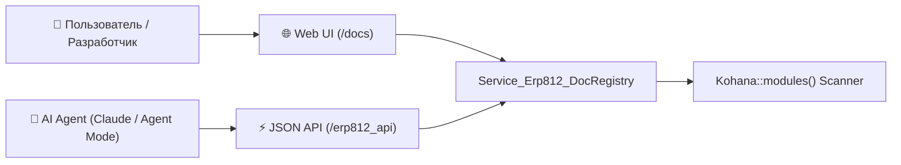

# Модуль интерактивной документации PromERP (`erp812_docs`)

Модуль предоставляет визуальную интерактивную архитектурную и пользовательскую документацию PromERP:
- **Интерактивные диаграммы Mermaid**: Сквозные бизнес-процессы (P2P, O2C, Производство, Склад), многоуровневая архитектура ядра, схемы изоляции баз данных PostgreSQL.
- **Автоматический сбор метаданных (DocRegistry)**: Сканирование всех модулей ядра через `Kohana::modules()`, чтение `README.md`, маршрутов из `init.php`, таблиц из миграций `migrations_pg/`, инструментов `mcp.php`, прав доступа ACL.
- **Интерактивный поисковый индекс**: Мгновенный полнотекстовый поиск по процессам, модулям, таблицам БД и инструментам AI.
- **100% Offline-First**: Mermaid.js и вспомогательные библиотеки размещены локально без обращений к сторонним CDN.

## Основные разделы
- `/docs` — Главный экран с обзором системы и поиском.
- `/docs/processes` — Интерактивные схемы сквозных бизнес-процессов с пошаговой детализацией.
- `/docs/modules` — Каталог модулей с фильтрацией по категориям.
- `/docs/modules/<name>` — Карточка модуля со структурой таблиц, API маршрутами и README.
- `/docs/architecture` — Обзор архитектурных слоев и принципов изоляции данных.
- `/docs/mcp` — Каталог MCP инструментов для AI-агентов.
- `/erp812_api/*` — REST API для полнотекстового поиска и экспорта спецификаций.

## Схема взаимодействия

